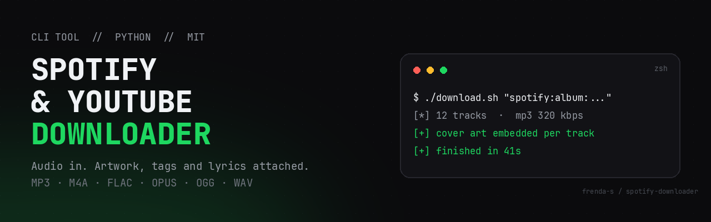

# Spotify and YouTube Downloader



A command-line tool that turns Spotify albums, playlists, tracks, or YouTube videos into local audio files with cover artwork and ID3 tags embedded.

---

## Features

- **Dual source routing:** Handles Spotify tracks, albums, and playlists via `spotdl`, and YouTube videos, playlists, or Shorts via `yt-dlp`.
- **Embedded metadata and artwork:** ID3 metadata tags (artist, title, album, track number) and high-resolution cover art are written directly into the audio container.
- **Multiple formats:** Output to MP3 (default 320 kbps), M4A (AAC), FLAC (lossless), OPUS, OGG, or WAV.
- **Parallel processing:** Configurable multi-threaded downloading for large playlists and discographies.
- **Synced lyrics:** Optional `--lyrics` flag to embed synchronized lyrics and export `.lrc` companion files.
- **Cover export:** Optional `--save-cover` flag to write separate `.jpg` files per track alongside a folder-level `cover.jpg`.
- **Zero cloud dependencies:** Processing runs entirely on your local machine with no external API keys or subscription required.

---

## Prerequisites

- **Python:** 3.9 or newer.
- **FFmpeg:** Required for audio transcoding and metadata embedding.
  - Linux (Arch/CachyOS): `sudo pacman -S ffmpeg`
  - Linux (Debian/Ubuntu): `sudo apt install ffmpeg`
  - macOS: `brew install ffmpeg`

---

## Installation

Clone the repository and install the dependencies in a virtual environment:

```bash
git clone https://github.com/frenda-s/spotify-downloader.git
cd spotify-downloader

python3 -m venv .venv
source .venv/bin/activate
pip install --upgrade pip
pip install -r requirements.txt
```

---

## Usage

### 1. Interactive Mode

Run the shell script for an interactive terminal prompt:

```bash
chmod +x download.sh
./download.sh
```

You will be prompted for:
1. Target URL (Spotify or YouTube link)
2. Destination directory (defaults to `~/Downloads`)
3. Audio format (MP3 320k, M4A, FLAC, OPUS)
4. Optional flags (synced lyrics, cover extraction)

### 2. Command-Line Interface

Invoke the Python entry point directly with flags for automation, scripts, or cron jobs:

```bash
# Basic download to default ~/Downloads directory (MP3 320 kbps)
python3 spotify_downloader.py "https://open.spotify.com/album/4aawyAB9vmqN3uQFRjYTkK"

# Specify custom destination and FLAC lossless format
python3 spotify_downloader.py "https://open.spotify.com/playlist/37i9dQZF1DXcBWIGoYBM5M" \
    --output ~/Music/Playlists \
    --format flac \
    --threads 8

# YouTube video with cover export and M4A container
python3 spotify_downloader.py "https://www.youtube.com/watch?v=dQw4w9WgXcQ" \
    --output ~/Music/Singles \
    --format m4a \
    --save-cover

# Fetch synchronized lyrics (.lrc files)
python3 spotify_downloader.py "https://open.spotify.com/track/4cOdK2wGLETKBW3PvgPWqT" \
    --lyrics
```

---

## CLI Options

| Argument | Description | Default |
|---|---|---|
| `query` | Spotify URL, YouTube URL, or search query | *Required* |
| `-o, --output` | Target folder for saved files | `~/Downloads` |
| `-f, --format` | Container format (`mp3`, `m4a`, `flac`, `opus`, `ogg`, `wav`) | `mp3` |
| `-b, --bitrate` | Audio bitrate (`320k`, `256k`, `192k`, `auto`) | `320k` |
| `-t, --threads` | Concurrent download threads | `4` |
| `--save-cover` | Export standalone `.jpg` cover files alongside tracks | `False` |
| `--lyrics` | Fetch synced lyrics and generate `.lrc` files | `False` |
| `--overwrite` | Policy for existing files (`skip`, `metadata`, `force`) | `skip` |
| `--version` | Display program version | |

---

## File Structure

```
spotify-downloader/
├── download.sh            Interactive terminal wrapper
├── spotify_downloader.py  Core CLI routing and metadata engine
├── tests/test_smoke.py    Routing, command-shape and cover-extraction checks
├── tools/make_banner.py   Banner generation script
├── requirements.txt       Python dependencies
├── assets/banner.png      Repository header banner
└── README.md              Documentation
```

## Tests

```bash
.venv/bin/python tests/test_smoke.py
```

The suite checks URL routing, the exact flag set handed to `spotdl` and `yt-dlp`, missing-binary handling, and cover extraction from an MP3 built on the fly with `ffmpeg`. It needs no network access.

---

## Disclaimer

This utility is developed for personal offline listening and backup purposes for content you already own or have the rights to access. Please respect copyright laws and the terms of service of the respective platforms.

## License

MIT License. See LICENSE for details.
